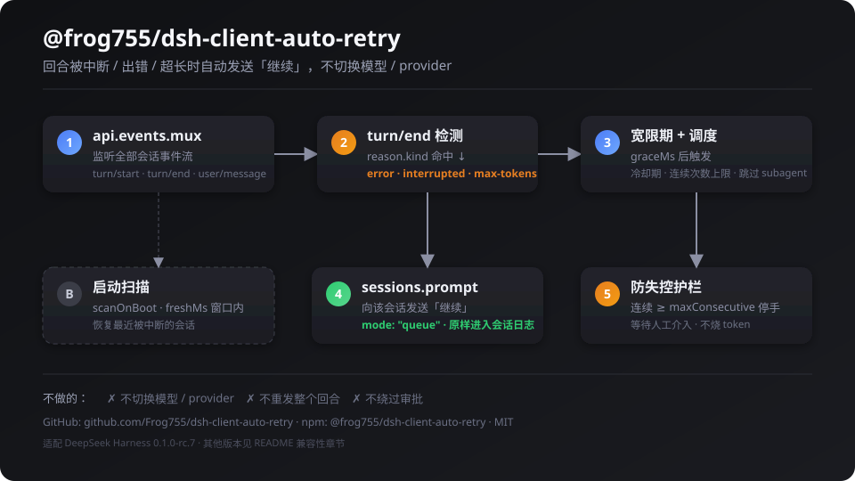
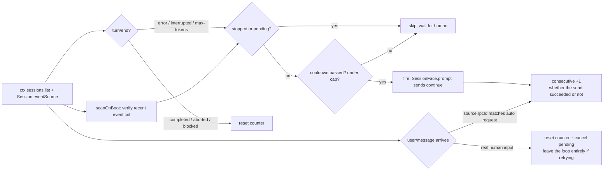

# @frog755/dsh-client-auto-retry

[](https://awesome-dsh-plugin.com)
[](https://www.npmjs.com/package/@frog755/dsh-client-auto-retry)

> A DeepSeek Harness (DSH) **client plugin** that detects interrupted / errored /
> overlong (`max-tokens`) turns and automatically sends a "继续 / continue" prompt
> to resume them. It only retries — it does **not** switch models or providers.
> Ships with a settings card.

中文版: [README.md](./README.md)

<p align="center">
  
</p>

---

## 📺 Video Demo

Douyin explainer video (real 429 auto-resume demo + 1-minute walkthrough):

<https://v.douyin.com/FAT_Vlsd_AU/>

---

## What it does

DSH turns occasionally get interrupted by network flakiness, provider errors,
timeouts, or hitting the output token ceiling. In most cases the model has already
done most of the work — sending one more "continue" prompt lets it finish, with no
human intervention and no model switch.

This plugin:

1. Observes `ctx.sessions.list` and each retained Session's `eventSource`;
2. When a `turn/end` arrives with `reason.kind ∈ { error, interrupted, max-tokens }`,
   waits a grace period (default 5s, giving the Host time to recover);
3. Calls the current `SessionFace.prompt()` with a configurable "继续" message;
4. Uses per-Session cooldown, in-flight locking, max consecutive attempts,
   request-id echo matching, and verified boot-time recovery.

## Install

### A. From npm (recommended)

Inside your DSH profile directory (e.g. `~/.dsh/profiles/web`):

```powershell
pnpm add @frog755/dsh-client-auto-retry
```

Then add `@frog755/dsh-client-auto-retry` to `dsh.profile.bundles` in the profile's
`package.json` (the package ships a `cordis.patch.yml` that inserts the
`auto-retry` row into the plugin roster as a bundle layer):

```jsonc
{
  "dependencies": {
    "@frog755/dsh-client-auto-retry": "^0.5.1"
  },
  "dsh": {
    "profile": {
      "bundles": [
        "@deepseek-ai/dsh-base",
        "@deepseek-ai/dsh-web-app",
        // ... other bundles ...
        "@frog755/dsh-client-auto-retry"
      ]
    }
  }
}
```

Then:

```powershell
pnpm install
```

**Restart DeepSeek Harness** (host-side plugins load only once per process), then
refresh the browser page.

### B. Local link for development

```jsonc
{
  "dependencies": {
    "@frog755/dsh-client-auto-retry": "link:C:/Users/frog/.dsh/projects/dsh-client-auto-retry"
  }
}
```

Client changes under `lib/` apply on page refresh; host changes (`lib/index.js`)
need a restart.

## Settings

Settings entry: **Settings → General → Auto Retry**. All fields apply live through the
current DSH ConfigForms mirror.

| Field | Default | Meaning |
| --- | --- | --- |
| `graceMs` | `5000` | How long to wait after an interruption before auto-sending "continue" (ms) |
| `cooldownMs` | `20000` | Minimum interval between two auto-continues for the same session |
| `maxConsecutive` | `4` | Stop auto-retrying after this many consecutive attempts; wait for a human |
| `maxBackoffMs` | `300000` | Cap for exponential backoff between consecutive attempts |
| `continueText` | `继续` | The text to send |
| `echoWindowMs` | `30000` | Retained for settings compatibility; current DSH echo matching uses the durable request id |
| `scanOnBoot` | `true` | Scan recent Session event tails on page load and resume only verified interruptions |
| `freshMs` | `900000` | Scan window: only sessions touched within this many ms |
| `verbose` | `true` | Print `[auto-retry]` debug logs to the browser console |

## How it works



All core logic lives in `AutoRetryRunner` in `lib/client.js`; `lib/index.js` (the
host half) only registers the settings schema.

## Compatibility notes (important)

> 📖 Full version: [docs/COMPATIBILITY.md](docs/COMPATIBILITY.md) (with a debugging checklist and an index of modification points).

### Tested version

This plugin `0.5.x` was written and verified against **DSH `0.2.1-rc.5`** in the current environment and the same 0.2.x API surface. It uses the dynamic Cordis client half, Session Controller, and ConfigForms; it does not support the old 0.1.x ModuleLoader / `connection.api` API.

### DSH API surface this plugin depends on

| # | Dependency | DSH 0.2.x shape |
| --- | --- | --- |
| 1 | Client half | `lib/client.js` returns `{ inject, apply }` directly; no `require`, JSX, or `window.__ModuleLoader__`. |
| 2 | Session list | `ctx.sessions.list.getSnapshot()` returns `{ ids, byId }` and publishes via `subscribe()`. |
| 3 | Session events | `ctx.sessions.retain(id, { source })` → `SessionReference.ready` → `SessionBinding.eventSource`, whose durable entries carry `seq`. |
| 4 | Sending continue | `beginSubmission(...)` followed by `session.prompt(content, 'queue', signal, requestId)` returns a `RemoteResult`. |
| 5 | Echo identity | Current DSH echoes the submission request id as `user/message.source.rpcId`; the plugin matches it exactly. |
| 6 | Host settings | Named `Config` export with `.volatile()` fields; Host uses `settings.configure({ auto: false })`. |
| 7 | Settings card | `ctx.configForms.get(NS)` plus `getSnapshot/subscribe/mutate`; the card is registered through current slots. |
| 8 | Bundle compatibility | `engines.dsh` declares `>=0.2.1-rc.5 <0.3.0`; `dsh.bundle.patch` inserts the roster row. |

### Debugging checklist

1. Open DevTools console and look for `[auto-retry]` logs (`verbose` is on by default).
2. Plugin row not loading at all: confirm `dsh.profile.bundles` includes
   `dsh-client-auto-retry` and DSH was restarted.
3. Loaded but never fires: verify the target is in `ctx.sessions.list`, is not a
   subagent, and its retained event tail ends in a retryable `turn/end`.
4. Fires but send fails: inspect the Session `RemoteResult.error.code` and retain/open logs.
5. No settings card: verify the current settings, locale, renderer, and Session Controller
   bundles are composed and every Host `Config` field is `.volatile()`.

### Common pitfalls

- **Host-side changes need a DSH restart** — `lib/index.js` changes won't apply on
  refresh alone.
- **Don't set `maxConsecutive` too high** — if the provider keeps failing, retries
  just burn tokens; keep the default ≤ 4 and let the plugin stop for human input.
  While a retry loop is running you can also click **⏹ Stop retrying** on the left of
  the composer toolbar to leave it immediately.
- **`scanOnBoot` only touches sessions within `freshMs`** — stale sessions won't be
  poked after a long downtime.
- **It is not an error fallback** — it only sends "continue", it does not switch
  models/providers; configure failover in DSH's model routing if you need it.

## Development

```powershell
# Plain ESM, no build step — edit and reload
# Client: refresh the page
# Host: restart DSH
```

Log prefix: `[auto-retry]`. Set `verbose: false` to silence non-critical logs
(connection logs still print).

## Acknowledgements

Development and daily testing of this plugin used free model credits from
Alibaba Cloud Bailian (student-verified accounts receive ¥300 credit, covering
most mainstream domestic models):

<https://university.aliyun.com/course/promotion27-activity?clubTaskBiz=subTask..12810055..10280..&userCode=hbs5sljx>

## License

MIT
